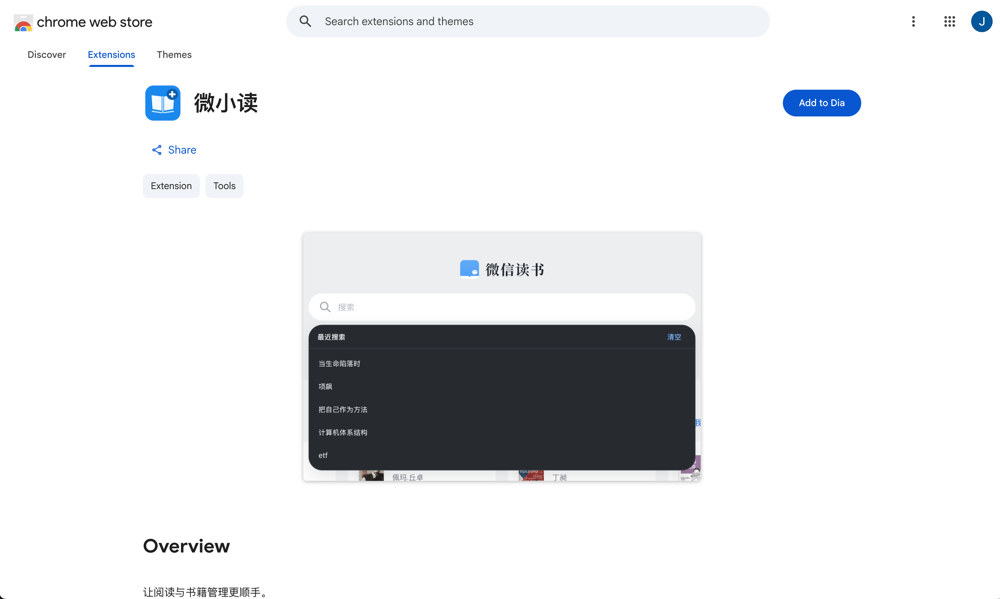

<div align="center">


# 微小读

### 找过的书，接着找。想读的书，顺手收。

为微信读书网页版补上「最近搜索」「封面简介预览」和「快捷加入书架」的轻量 Chrome 扩展。

**[从 Chrome 应用商店安装](https://chromewebstore.google.com/detail/微小读/hphcgidfoaoaialodjonbchniaaoenki)** · [功能预览](#功能预览) · [安装指南](#开始使用) · [反馈建议](https://github.com/JDChi/wee-read-web/issues)

无需注册扩展账号 · 搜索记录本地保存 · 沿用微信读书登录状态

</div>

---

## 少输一次书名，少开一个页面

昨天搜过的书，今天不用再输一遍；在搜索结果里遇到想读的书，点一下就能收入书架。

想先了解内容时，把鼠标停在封面上就能看简介。

## 功能预览

### 搜过的书，不用从头想

点击空白搜索框，即可查看最近 5 个不同的搜索词。点选一条就能重新搜索，也可以一键清空，让下一次找书从上次的线索开始。



### 鼠标停在封面上看简介

在首页搜索结果或「查看全部」页，把鼠标停在电子书、网文或杂志的封面上，简介会从封面处展开。浮层显示可用的作者和出版信息，长简介可在浮层内滚动，按 Esc 可关闭。

### 看到想读的，直接加入书架

在搜索结果页，尚未加入书架的可读书籍会显示「加入书架」按钮。无需先进入书籍详情，点击即可收藏，加入成功后按钮自动隐藏。


### 小功能，轻装上阵

- **打开就能用**：沿用你已登录的微信读书账号，无需额外注册。
- **记录留在本地**：最近搜索保存在当前浏览器，可以随时清空。
- **贴合阅读习惯**：支持最近搜索的键盘操作，适配系统深色模式。

## 开始使用

### 从 Chrome 应用商店安装

1. 打开[微小读商店页面](https://chromewebstore.google.com/detail/微小读/hphcgidfoaoaialodjonbchniaaoenki)，将扩展添加到浏览器。
2. 打开或刷新[微信读书网页版](https://weread.qq.com/)，登录后即可使用。

### 手动加载：发布包或源码

<details>
<summary>展开手动安装步骤</summary>

1. [下载最新版](https://github.com/JDChi/wee-read-web/releases/latest)，在 Release 的 **Assets** 中选择 `wee-read-web-版本号.zip`，解压到固定文件夹。
2. 在 Chrome 打开 `chrome://extensions`，开启右上角的「开发者模式」。
3. 点击「加载已解压的扩展程序」，选择解压后**直接包含 `manifest.json` 的文件夹**。
4. 打开或刷新[微信读书网页版](https://weread.qq.com/)，登录后开始使用。

已经下载了源码？第 3 步直接选择仓库内的 **`extension` 文件夹**，无需安装依赖或构建。

**手动更新**：将新版发布包解压覆盖到原文件夹，在 `chrome://extensions` 点击微小读卡片上的刷新按钮，再刷新微信读书页面。请保留加载扩展时选择的文件夹。

</details>

## 你的搜索记录，留在你的浏览器

微小读只在 `weread.qq.com` 页面运行。最近搜索保存在 Chrome 扩展本地存储中，书架查询与操作沿用你当前的微信读书登录状态。搜索列表缺少简介时，扩展在悬停后向微信读书请求该书的公开阅读页，获取的简介和出版信息仅缓存在当前页面。扩展不读取或保存登录凭证，也不会把搜索词、书架数据或浏览内容发送到开发者服务器。

查看完整[隐私政策](PRIVACY.md)。

<details>
<summary>开发与打包</summary>

项目使用原生 JavaScript、CSS 和 Chrome Manifest V3，无需安装依赖。加载 `extension/` 目录即可开发；修改代码后，刷新扩展及微信读书页面。

```sh
sh scripts/package.sh
```

打包需要 `python3` 和 `zip`，产物为 `dist/wee-read-web-版本号.zip`，版本号取自 `extension/manifest.json`。图标资源位于 `extension/icons/`。

推送与 manifest 版本一致的 `v*` 标签时，GitHub Actions 会自动打包并创建 GitHub Release。

</details>

---

有想补上的小功能，或遇到页面适配问题？欢迎[提一个 Issue](https://github.com/JDChi/wee-read-web/issues)。也欢迎给项目点个 Star，让更多微信读书用户发现微小读。

[安装微小读](https://chromewebstore.google.com/detail/微小读/hphcgidfoaoaialodjonbchniaaoenki) · [查看更新记录](https://github.com/JDChi/wee-read-web/releases) · [打开微信读书](https://weread.qq.com/)

<sub>微小读（wee-read-web）是独立开发的非官方扩展，与微信读书或腾讯无隶属关系。微信读书网页结构或接口变化时，部分功能可能需要更新适配。</sub>
